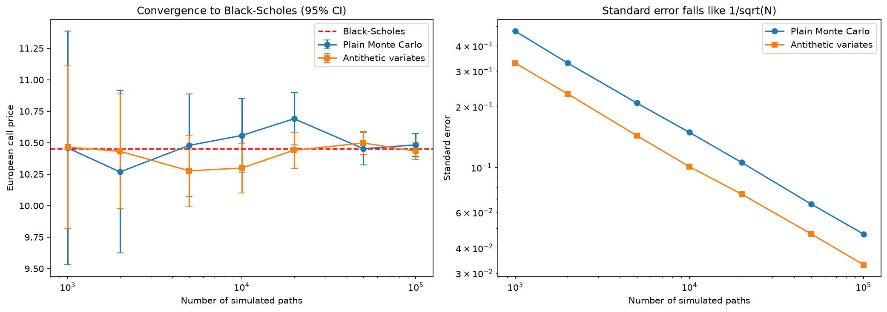
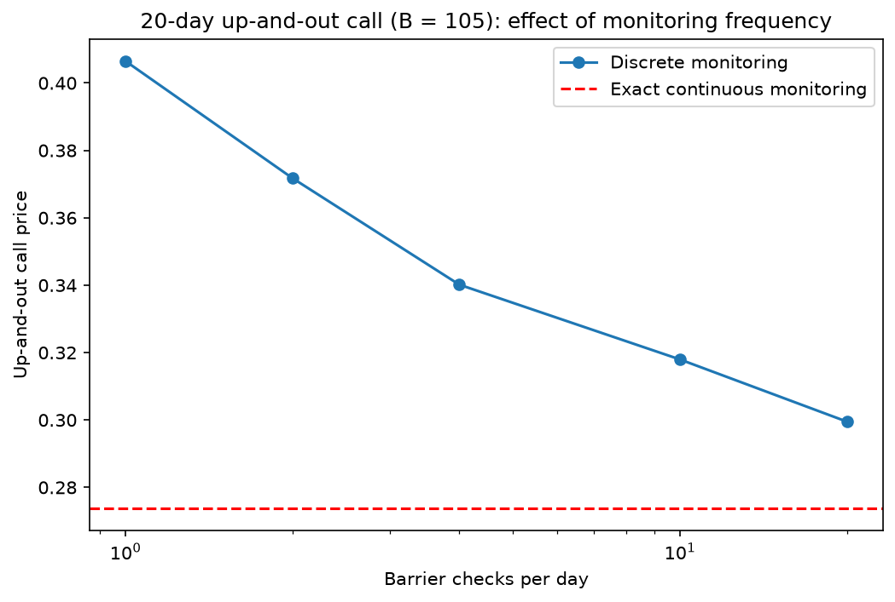

# Monte Carlo Option Pricing Engine

A vectorised Monte Carlo pricer in Python for European, Asian, barrier and American
(Longstaff-Schwartz) options under risk-neutral geometric Brownian motion, validated against
Black-Scholes and parity relationships.



## Key results

Standard inputs: S0 = 100, K = 100, 1 year, r = 5%, volatility 20%, 100,000 paths, seed 42.

- **Validation:** European call 10.48 against Black-Scholes 10.45 (inside the 95% confidence interval at five strikes). Eight independent checks, including put-call parity and in-out parity, agree to within 1%.
- **Convergence:** four times as many paths halves the standard error. Antithetic variates cut it by 29%, equivalent to about twice as many paths.
- **Asian options:** the Asian call costs 5.79 against 10.48 for the European call, because averaging reduces volatility.
- **American options:** the American put is worth 6.06 against 5.57 for the European put (early-exercise premium 0.49). The American call equals the European call, as theory says when there are no dividends.
- **Research question:** for a 20-day up-and-out call with a barrier at 105, checking the barrier once a day overprices by 48% and twice a day by 36%, compared with the exact continuous-monitoring price. A Broadie-Glasserman-Kou barrier shift reduces the error to about 1% at no extra cost.
- **Greeks:** finite differences with common random numbers reproduce the Black-Scholes delta, gamma, vega and rho to within 2%.



## Structure

- `src/pricer.py`: the pricing engine (`price_option` is the entry point)
- `notebooks/monte_carlo_analysis.ipynb`: validation, charts and discussion
- `outputs/`: saved charts

## How to run

```
python -m venv .venv
.venv\Scripts\Activate.ps1
python -m pip install -r requirements.txt
```

Then open the notebook, select the `.venv` kernel and choose Restart and Run All.

## Limitations

Constant volatility and interest rate, no jumps and no dividends. Barriers are monitored on the
time grid only. The Longstaff-Schwartz price tends to be slightly low and was not checked against
an independent method.
